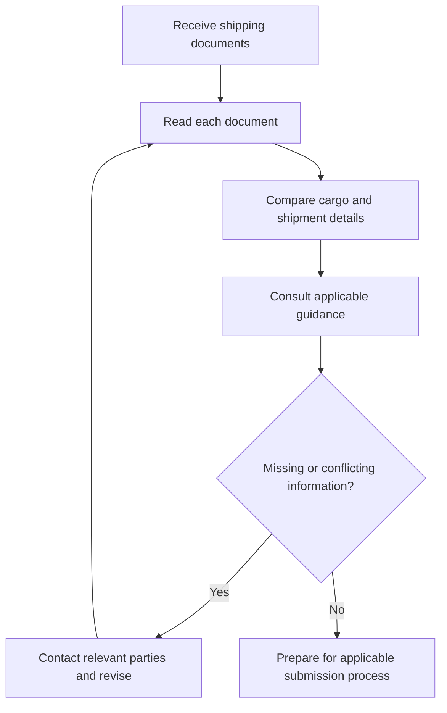
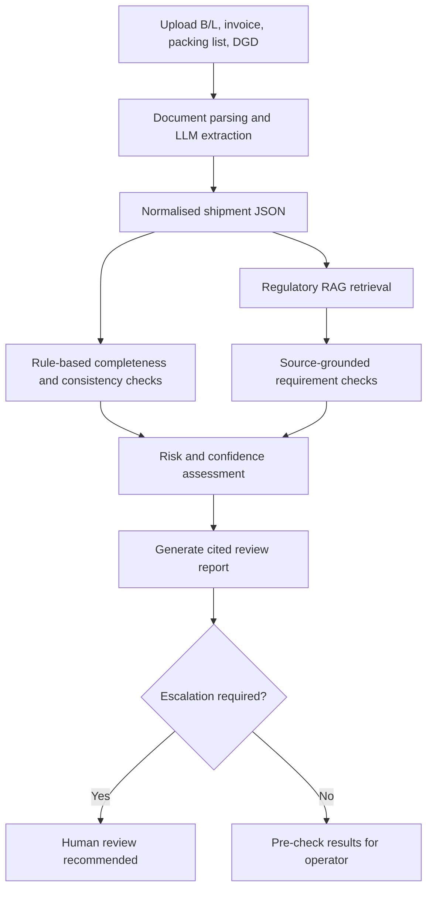
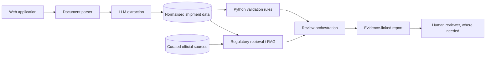

# Maritime DG Compliance Assistant

### AI-Powered Document Intelligence for Dangerous Goods Shipments in Singapore

**From fragmented shipping documents to explainable, risk-aware compliance pre-checks.**

*An academic prototype for document pre-validation — not an official regulatory clearance service.*

---

## Overview

Maritime dangerous-goods (DG) shipments involve multiple documents that must tell a consistent story about the same cargo. Details such as **UN number, dangerous-goods class, cargo description, container number, gross weight, and shipment parties** may appear across several documents in different formats.

Freight forwarders and shipping documentation officers often need to gather these records, reconcile differences, and consult applicable guidance before documents proceed through official channels. This project explores how **large language models (LLMs), retrieval-augmented generation (RAG), AI agents, and deterministic validation rules** can support that work.

Our proposed solution is a **human-in-the-loop compliance pre-check assistant** that extracts shipment information, flags discrepancies, retrieves supporting requirements, and generates an explainable review report.

> **Project question:** How can an AI-powered document intelligence and RAG system reduce the effort of reviewing maritime dangerous-goods documentation and help detect inconsistencies before submission in Singapore?

## Why This Matters

Singapore is a major maritime hub. According to the Maritime and Port Authority of Singapore (MPA), the port handled **44.66 million TEUs in 2025** and recorded **3.22 billion gross tonnage of vessel arrivals** ([MPA, 13 January 2026](https://www.mpa.gov.sg/media-centre/details/singapore-posts-record-port-performance-in-2025-and-develops-future-readiness-through-industry-collaborations-for-2026)).

Dangerous goods require particular care: errors in shipment information can trigger rework, clarification, further review, or operational delays, while some misclassifications can pose safety concerns. The following are the *business problems this prototype aims to address*, not claims of measured performance in a particular company:

| Challenge | Why it matters | Proposed response |
| :--- | :--- | :--- |
| **Fragmented documents** | Information is spread across PDFs and differently formatted forms. | LLM-assisted document extraction into a common schema. |
| **Inconsistent data** | Container IDs, weights, cargo details, or DG classifications may conflict. | Deterministic cross-document checks. |
| **Missing information** | Gaps may require follow-up before a shipment is ready for submission. | Field- and document-completeness checks. |
| **Distributed requirements** | Staff must consult the relevant official guidance. | Singapore-focused regulatory RAG with citations. |
| **Uneven case complexity** | Not every discrepancy warrants the same response. | Risk-based flags and human escalation. |
| **Repetitive reporting** | Reviewers need to communicate what is wrong and why. | Evidence-linked compliance pre-check summaries. |

  

  

  

### Intended users

- **Primary:** Freight forwarders and shipping documentation officers conducting pre-submission reviews.
- **Secondary:** Shipping agents, declaring agents, and compliance reviewers who may use the findings as supporting information.

Official declaration and approval responsibilities remain with the applicable parties and authorities. For example, MPA specifies DG notification obligations for vessel owners, agents, or masters; Singapore Customs describes a separate permit process through **TradeNet**.

## Project Scope

| In scope (initial prototype) | Out of scope |
| :--- | :--- |
| Containerised **packaged** dangerous goods involving Singapore | Bulk liquid/gas/solid cargo regimes |
| Four common shipment document types | Every possible certificate, approval, or terminal workflow |
| Extracting and reconciling key shipment fields | Guaranteed determination of correct cargo classification |
| Selected, source-backed Singapore DG requirements | Universal or fully up-to-date legal compliance coverage |
| Risk-based reviewer recommendations | Filing permits, submitting DG declarations, or issuing approvals |
| Synthetic shipment data for testing | Processing real customer shipment records in the demo |

**Initial document set:**

1. **Bill of Lading (B/L)** — transport and shipment details.
2. **Commercial Invoice** — parties, cargo description, and commercial details.
3. **Packing List** — packaging, quantities, and weights.
4. **Dangerous Goods Declaration (DGD)** — declared dangerous-goods information.

> **Scope decision to finalise:** The team should specify one movement scenario (e.g., containerised DG imports into Singapore) before implementing regulatory checks. Import, export, and transhipment requirements should not be treated as identical.

## Current vs Proposed Workflow

### Representative manual pre-check workflow

This diagram is an **illustrative workflow model** for the project, not a prescribed standard operating procedure for all Singapore operators.

### Planned AI-assisted workflow

## System Architecture (Planned)

### What each component does

| Component | Role |
| :--- | :--- |
| **LLM** | Extract structured information from documents and produce readable explanations. |
| **Python rules** | Compare exact values, detect missing fields, and apply explicitly encoded checks. |
| **RAG** | Retrieve relevant passages from a curated, versioned Singapore-specific regulatory knowledge base. |
| **Agent / orchestrator** | Coordinate extraction, validation, retrieval, and reporting stages. |
| **Human reviewer** | Resolve ambiguous, high-impact, or insufficiently supported findings. |

RAG retrieves regulatory evidence; it does **not** itself establish that a shipment is compliant. Any regulatory check must correctly identify the applicable rule, its conditions, and the evidence in the shipment documents.

## Key Fields to Extract

| Category | Example fields |
| :--- | :--- |
| Shipment | Transport document number, shipment reference, date, vessel/voyage, ports of loading/discharge |
| Parties | Shipper/consignor, consignee, carrier |
| Cargo | Description, quantity, packaging, gross/net mass, volume where present |
| Dangerous goods | UN number, declared DG class, packing group where applicable, proper shipping name where present |
| Container | Container ID, seal number, container size/type where present |
| Commercial | HS code and invoice details where present |

Not every field must appear in every document. **Document-specific presence rules** and **cross-document comparisons** should be configured separately. Fields that are missing, unreadable, or not applicable should remain distinguishable; the model must not invent them.

## Synthetic Data & Demo Scenarios

The project will use fictional shipment records to generate realistic-looking documents without exposing commercial or personal shipment data. Correct documents will be derived from the same underlying shipment record; test documents will then introduce deliberate errors.

| Scenario | Deliberate test condition | Expected system behaviour |
| :--- | :--- | :--- |
| **Consistent shipment** | All expected fields agree. | No fabricated discrepancies; produce a sourced pre-check summary. |
| **Weight mismatch** | B/L and packing list show different values for a comparable weight field. | Flag the conflict and cite both document values. |
| **Container mismatch** | Different container IDs appear for the same shipment. | Flag the conflicting IDs and source documents. |
| **Missing DGD** | A DG shipment has no DGD in the expected document set. | Flag for review under the configured document policy. |
| **DG data conflict** | Declared UN number or class is inconsistent. | Flag as high-priority; request qualified human verification. |
| **Multiple issues** | Several missing or inconsistent fields. | Summarise all problems and recommend escalation. |

These are **planned test cases**, not demonstrated results.

## Risk & Human Review

The prototype will use a transparent, configurable triage policy rather than rely on a single opaque LLM score.

| Indicative category | Illustrative findings | Intended action |
| :--- | :--- | :--- |
| **Low** | Expected documents present; checks pass on the available evidence. | Generate a pre-check summary; **not** regulatory clearance. |
| **Medium** | Non-critical missing data, uncertain extraction, or unresolved comparisons. | Recommend document correction or reviewer confirmation. |
| **High** | DG classification conflict, significant missing declaration information, or unsupported regulatory conclusion. | Escalate to a qualified human reviewer. |

**Extraction confidence, rule outcomes, and regulatory evidence coverage are separate signals.** A high-confidence extraction does not imply that the shipment is legally compliant.

## Evaluation Plan

We will assess the prototype on labelled synthetic shipments, including cases with known injected errors.

| Metric | Evaluation question |
| :--- | :--- |
| **Field extraction accuracy** | Were the correct values captured from documents? |
| **Discrepancy precision and recall** | Did the system flag actual inconsistencies without excessive false alarms? |
| **Document completeness detection** | Did it recognise deliberately missing required files/fields? |
| **Retrieval relevance / citation support** | Were retrieved sources relevant, and do they support the reported findings? |
| **Escalation correctness** | Were pre-labelled high-priority cases sent for human review? |
| **Processing time** | How long did an automated pre-check take per synthetic shipment? |

Any claims of time savings should be reported only after measurement against a defined manual baseline. Test data, expected outputs, and observed results should be kept separate.

## Project Workstreams

| Workstream | Responsibility |
| :--- | :--- |
| **1. Business problem & research** | Industry context, target users, representative workflow, pain points, business value, requirements handover. |
| **2. Regulatory knowledge base** | Identify authoritative sources, scope applicability, curate and version evidence for RAG. |
| **3. Synthetic shipment data** | Build ground-truth shipment records, sample documents, and controlled error cases. |
| **4. Extraction & validation engine** | Parse documents, produce structured JSON, and implement comparison/completeness checks. |
| **5. RAG, reporting & interface** | Retrieve requirements, orchestrate checks, provide an upload interface and explainable output. |

Integration, testing, evaluation, and the recorded demo are shared responsibilities.

## Implementation Status

- [ ] Finalise movement scenario and shipment schema
- [ ] Curate Singapore-specific regulatory sources and applicability rules
- [ ] Generate synthetic documents with labelled expected outcomes
- [ ] Implement document extraction into structured JSON
- [ ] Implement deterministic cross-document validation
- [ ] Integrate source-grounded regulatory retrieval
- [ ] Add risk triage and report generation
- [ ] Build user-facing upload and results interface
- [ ] Evaluate against synthetic test cases
- [ ] Record prototype demonstration

> **Repository setup:** Commands, dependencies, deployment instructions, screenshots, and a live demo URL will be added once the application stack and code structure are finalised. No executable setup is implied by this README alone.

## Authoritative References

These are starting sources for research and RAG curation. Their content, applicability, effective dates, and any incorporated amendments must be checked before implementing regulatory rules.

1. [Maritime and Port Authority of Singapore — Declaring Dangerous Goods](https://www.mpa.gov.sg/port-marine-ops/operations/gas-free-hazardous-cargo-info/declaring-dangerous-goods)
2. [Maritime and Port Authority of Singapore — 2025 Port Performance](https://www.mpa.gov.sg/media-centre/details/singapore-posts-record-port-performance-in-2025-and-develops-future-readiness-through-industry-collaborations-for-2026)
3. [Singapore Customs — Obtain a Customs Import Permit](https://www.customs.gov.sg/doing-business/import-operations/import-procedures/obtain-a-customs-import-permit/)
4. [Singapore Customs — Controlled Goods and Competent Authorities](https://www.customs.gov.sg/doing-business/quick-links-for-traders/tradenet/competent-authorities-requirements-for-controlled-items/competent-authorities-requirements-for-controlled-items-overview/)
5. [International Maritime Organization — IMDG Code](https://www.imo.org/en/publications/pages/imdg%20code.aspx)

**Important distinctions:** The IMDG Code governs international maritime dangerous-goods carriage; Singapore MPA requirements, Singapore Customs permit rules, and terminal/operator procedures concern different parts of the overall process. A UN number, DG class, and HS code serve different purposes and should not be treated as interchangeable classifications. Regulatory texts may be licensed, amended, or not fully accessible online; the team should confirm that any RAG material is lawfully usable and current.

## Safety, Ethics & Limitations

- **Not a regulatory authority:** The prototype cannot approve dangerous goods, issue permits, or certify compliance.
- **Human oversight:** High-risk and uncertain findings require a knowledgeable reviewer.
- **Hallucination controls:** Findings should reference source documents and identifiable regulatory evidence; unsupported conclusions must be marked uncertain.
- **Document security:** Prototype testing uses synthetic data. Any future real-world deployment would require access controls, appropriate retention policies, and protection for commercial information.
- **Regulatory changes:** RAG is only as current and complete as the curated knowledge base; retrieval does not guarantee exhaustive coverage.
- **Scope:** The initial demonstration addresses selected document and rule checks, not end-to-end maritime clearance.

---

**Built as a student project exploring practical LLM, RAG, agent orchestration, and human-in-the-loop validation.**

*Detect earlier · Explain clearly · Escalate responsibly*

