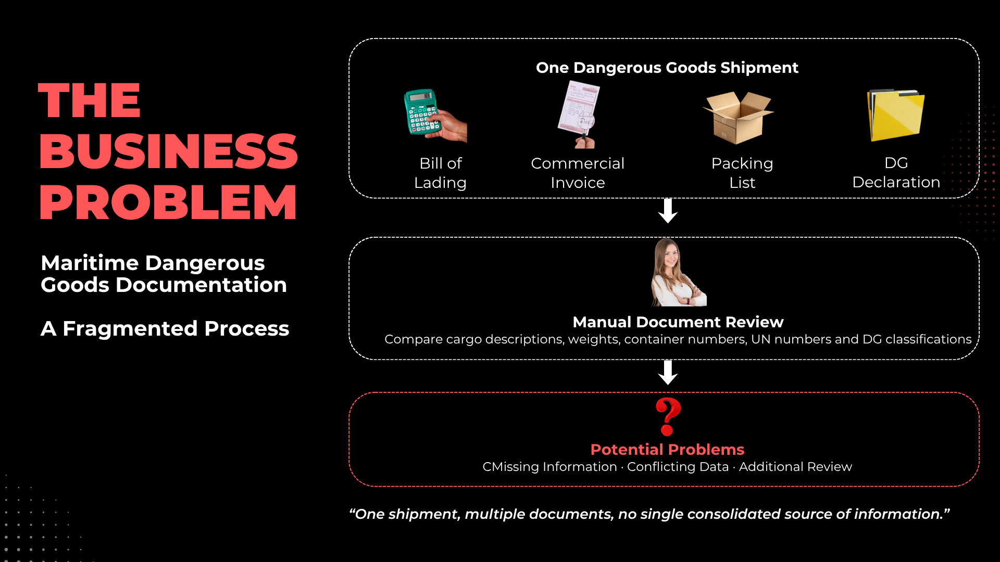
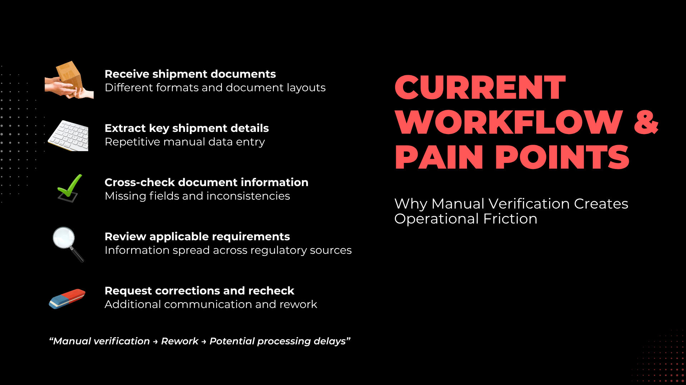
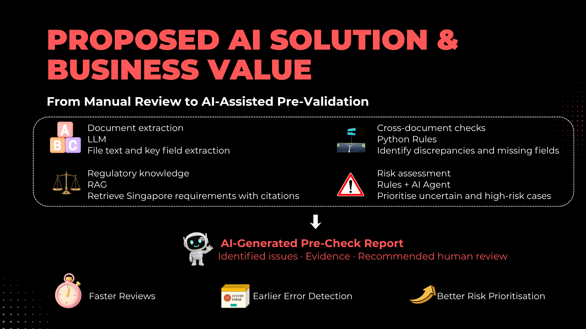
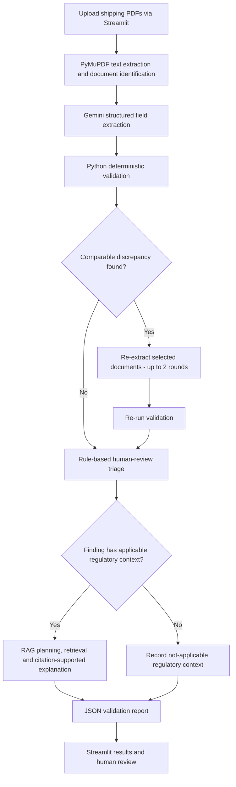
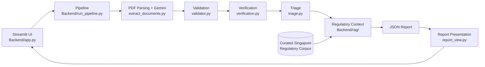
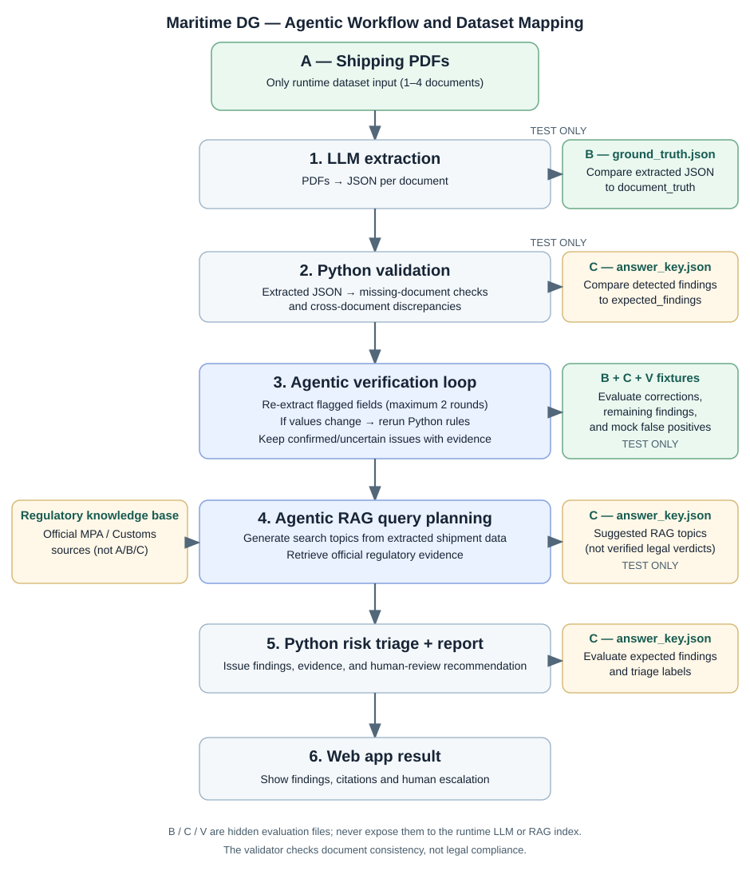

<div align="center">

# Maritime DG Compliance Assistant

### AI-Powered Document Intelligence for Dangerous Goods Shipments in Singapore

**From fragmented shipping documents to explainable, human-in-the-loop document pre-checks.**


*An academic prototype for dangerous-goods document pre-validation — not an official regulatory clearance service.*

**[🌐 Launch PortDoc AI — Live Streamlit Application](https://access-qsmjvmponxnnxjuvgnfdyz.streamlit.app/)**

</div>

---

## 1. Project Overview

Maritime dangerous-goods (DG) shipments involve multiple documents that must contain consistent information about the same cargo. Details such as **UN number, DG class, cargo description, container number, gross weight and shipment parties** may appear across different shipping documents.

Manually cross-referencing these records can be repetitive and may delay the identification of documentation inconsistencies.

**PortDoc AI** is a human-in-the-loop document intelligence prototype that combines:

- **Google Gemini** for structured PDF information extraction.
- **Deterministic Python validation** for selected cross-document consistency checks.
- **Bounded verification** to re-extract documents associated with flagged discrepancies.
- **Retrieval-Augmented Generation (RAG)** to provide supporting regulatory information with citations for applicable findings.
- **Rule-based triage** to suggest human-review priorities.
- **Streamlit** for document upload, results presentation and report review.

> **Project question:** How might AI automate the preliminary cross-referencing of fragmented maritime dangerous-goods documentation, helping identify inconsistencies earlier and supporting more efficient human review?

### Business Context

**Proposed client:** DHL Global Forwarding — Singapore ocean freight documentation and dangerous-goods operations.

**Project team role:** AI consulting team proposing a document pre-validation solution.

**Use case:** Containerised packaged dangerous-goods imports arriving in Singapore via PSA.

This is a **hypothetical academic use case**, not a commissioned DHL project. The business challenges and potential benefits are illustrative and are not claims of measured DHL operational performance.

## 2. Why This Matters

Singapore is a major global maritime hub. According to the Maritime and Port Authority of Singapore (MPA), Singapore handled **44.66 million TEUs in 2025**, with vessel arrivals totalling **3.22 billion gross tonnage** ([MPA, 13 January 2026](https://www.mpa.gov.sg/media-centre/details/singapore-posts-record-port-performance-in-2025-and-develops-future-readiness-through-industry-collaborations-for-2026)).

Dangerous-goods documentation requires careful review because missing or inconsistent information may lead to clarification, rework or operational delays.

| Business challenge | Why it matters | PortDoc AI approach |
|---|---|---|
| **Fragmented documentation** | Relevant information is distributed across multiple PDFs. | Extract document fields into structured JSON. |
| **Inconsistent shipment details** | Declared weights, container numbers or DG classes may conflict. | Apply deterministic cross-document validation. |
| **Extraction uncertainty** | AI extraction may introduce errors or omit information. | Re-extract selected documents and record incomplete checks. |
| **Distributed regulatory information** | Reviewers may need to consult multiple authoritative sources. | Retrieve source-backed regulatory context for applicable findings. |
| **Different review priorities** | Findings may require different levels of attention. | Suggest review priorities using transparent Python rules. |
| **Manual reporting** | Reviewers need clear, explainable results. | Present findings, evidence, citations and recommendations in Streamlit. |

<p align="center">
  
</p>

<p align="center">
  
</p>

<p align="center">
  
</p>

### Intended Users

- **Primary:** Freight forwarders and shipping documentation officers conducting preliminary document reviews.
- **Secondary:** Shipping agents, declaring agents and compliance reviewers who may use the findings as supporting information.

Official permit, notification and approval responsibilities remain with the relevant parties and authorities.

---

## 3. Project Scope

| In scope | Out of scope |
|---|---|
| Synthetic containerised packaged DG imports into Singapore via PSA | Bulk cargo regimes and every maritime movement scenario |
| Four common shipment document types | All possible shipping certificates and supporting documents |
| Selectable-text PDF extraction | OCR for scanned/image-only PDFs |
| Selected document-presence and field-consistency checks | Comprehensive DG classification or legal compliance validation |
| Re-extraction of flagged document groups | Guaranteeing that LLM-extracted values are correct |
| Singapore-focused regulatory RAG for applicable findings | Exhaustive or guaranteed-current regulatory coverage |
| Illustrative human-review priorities | Official legal risk classification |
| JSON reports and Streamlit review interface | Filing Customs permits, submitting DG notifications or granting approvals |

### Supported Shipping Documents

| Document | Purpose |
|---|---|
| **Bill of Lading (B/L)** | Transport details, shipment parties, container and cargo information |
| **Commercial Invoice** | Commercial parties, shipment description and invoice information |
| **Packing List** | Cargo quantities, packaging, container identifiers and weights |
| **Dangerous Goods Declaration (DGD)** | Declared dangerous-goods information, including UN number and DG class |

The prototype accepts a partial document set and reports missing or unreadable information where applicable.

The synthetic dataset specifically models **containerised packaged DG imports into Singapore via PSA**. Requirements for imports, exports and transhipments should not be assumed identical.

---

## 4. Implemented AI Workflow

The workflow below reflects the implementation in `feat/rag-in-pipeline`.



### Processing Stages

**1. PDF Upload and Identification**

Users upload selectable-text shipping PDFs through the Streamlit application. The system attempts to identify document types and records an upload inventory.

**2. Gemini Extraction**

The extraction module uses PyMuPDF and Gemini to produce structured fields, together with extraction metadata and available provenance.

**3. Deterministic Validation**

Python rules compare selected document values and identify missing documents, extraction failures and cross-document discrepancies.

**4. Verification Loop**

For supported discrepancy types, the system re-extracts selected whole documents, up to two rounds, and reruns validation. Findings that remain unresolved are retained for review.

**5. Human-Review Triage**

A deterministic Python policy assigns a suggested review priority based on the detected findings.

**6. Regulatory RAG**

For applicable findings, the system may generate a targeted regulatory question, retrieve relevant passages from a curated Singapore-focused corpus and produce citation-supported explanations.

The automatic regulatory-context integration focuses on DG-class conflicts and missing DGD findings. Other document-comparison findings may receive a not-applicable status.

**7. Reporting and Interface**

The pipeline saves structured JSON results. Streamlit presents document statuses, validation findings, supporting information and human-review recommendations.

The application also supports opening a saved report, loading a sample report and asking regulatory questions when live model access is available.

**Important:** Regulatory context supports human understanding. It does not establish whether the shipment satisfies Singapore regulatory requirements.

---

## 5. System Architecture



### Main Technologies

| Technology | Role |
|---|---|
| **Python** | Backend pipeline, deterministic validation and control logic |
| **Google Gemini API** | Structured document extraction and supported regulatory question answering |
| **PyMuPDF** | Reading text from PDFs |
| **Retrieval-Augmented Generation** | Retrieving source-backed regulatory passages |
| **scikit-learn** | Text retrieval support |
| **Streamlit** | Web application and report interface |
| **JSON** | Structured extraction results, reports and test references |
| **GitHub** | Source control and project collaboration |

### Key Backend Modules

```text
Backend/
├── app.py                  # Streamlit interface
├── extract_documents.py    # PDF parsing and Gemini extraction
├── run_pipeline.py         # End-to-end pipeline orchestration
├── validator.py            # Deterministic document checks
├── verification.py         # Bounded re-extraction
├── triage.py               # Review priority policy
├── report_view.py          # Report presentation
├── rag/
│   ├── planner.py          # Regulatory question planning
│   ├── retrieve.py         # Regulatory passage retrieval
│   ├── answer.py           # Source-grounded answers
│   ├── regulatory_context.py
│   └── corpus/             # Curated regulatory source texts
├── samples/                # Saved sample report
└── test_*.py               # Offline component tests
```

---

## 6. Document Validation and Verification

### Implemented Deterministic Checks

| Finding type | Check | Suggested action |
|---|---|---|
| `missing_document` | Required document not uploaded | Verify or correct document set |
| `extraction_failed` | Uploaded document could not be extracted | Re-run extraction / review |
| `weight_mismatch` | B/L vs Packing List gross cargo weight | Verify conflicting values |
| `container_mismatch` | Packing List vs B/L container identifier | Verify conflicting values |
| `dg_class_conflict` | B/L vs DGD dangerous-goods class | Qualified human review |

The implementation normalises supported representation differences, such as weights with commas and kilogram units, and DG-class values written as `CLASS 9` versus `9`.

### Verification Behaviour

The verification loop is triggered for supported comparison findings and re-extracts document groups associated with the discrepancy.

| Finding | Documents selected for re-extraction |
|---|---|
| Weight mismatch | B/L, Invoice, Packing List, DGD |
| Container mismatch | B/L, Packing List, DGD |
| DG class conflict | B/L, DGD |

Verification is bounded to **two rounds**.

A confirmed mismatch may remain after re-extraction. A false mismatch introduced by the first extraction may disappear.

Missing uploads and failed extractions are distinguished rather than treated as equivalent.

**Limitations:** Repeated extraction is not independent proof of correctness. The validator performs only its explicitly programmed checks and does not establish regulatory compliance.

---

## 7. Regulatory RAG and Human Review

The RAG component uses a curated collection of Singapore-relevant regulatory and operational sources.

Its main functions are:

- Planning targeted regulatory questions for applicable findings.
- Retrieving relevant source passages.
- Generating explanations constrained to retrieved evidence.
- Checking whether cited passage IDs and supporting quotations correspond to retrieved material.
- Returning unsupported or unavailable results without asserting a compliance verdict.

The current implementation automatically attaches regulatory context only where the configured finding policy considers it applicable.

### Illustrative Triage Policy

| Condition | Suggested priority | Human review |
|---|---|---|
| No findings | Low | Not automatically recommended |
| One weight mismatch | Medium | Recommended |
| One container mismatch | Medium | Recommended |
| One missing document | Medium | Recommended |
| DG class conflict | High | Recommended |
| Two or more findings | High | Recommended |

Uploaded documents that fail extraction require review because the corresponding checks may be incomplete.

These priorities are **prototype recommendations**, not legally defined risk classifications.

Even if no discrepancies are detected, the result is **not regulatory clearance**.

---

## 8. Synthetic Dataset and Test Scenarios

The repository includes a synthetic dataset designed for controlled testing of document extraction, validation, verification and triage.

**Dataset:** 6 scenarios · 23 PDFs · 6 ground-truth JSON files · 6 answer-key JSON files · 2 verification fixtures.

| Scenario | Injected condition | Expected findings |
|---|---|---|
| **S01 — Correct shipment** | No deliberate discrepancy | 0 |
| **S02 — Weight mismatch** | Packing List gross cargo weight differs | 1 |
| **S03 — Container mismatch** | B/L container ID differs | 1 |
| **S04 — Missing DGD** | DGD intentionally not uploaded | 1 |
| **S05 — DG class conflict** | DGD class differs from B/L | 1 |
| **S06 — Multiple errors** | Weight, container ID and DG class conflicts | 3 |

Five scenarios contain four PDFs each. S04 contains three.

### Dataset Structure

```text
data/
├── README.md
├── build.py
├── dataset_manifest.csv
├── system_workflow.svg
├── test_cases/
│   ├── S01_correct/
│   ├── S02_weight_mismatch/
│   ├── S03_container_mismatch/
│   ├── S04_missing_dgd/
│   ├── S05_dg_class_conflict/
│   └── S06_multiple_errors/
└── verification_fixtures/
    ├── V01_false_weight_mismatch.json
    └── V02_true_weight_mismatch.json
```

Each scenario includes the applicable shipping PDFs, `ground_truth.json` and `answer_key.json`.

- **A — PDFs:** Runtime test inputs.
- **B — Ground truth:** Reference values actually printed in each document.
- **C — Answer key:** Expected findings and related offline evaluation expectations.
- **V — Fixtures:** Mock extraction results for verification-loop testing.

**Only the synthetic PDFs are uploaded into the web application.** Ground truth, answer keys and verification fixtures are testing references, not runtime LLM answers.

The dataset uses one fictional shipment and controlled variations. It is suitable for an integration demonstration, **not a statistically representative accuracy benchmark**.

### Dataset Workflow Diagram



For detailed schema explanations, testing expectations and dataset limitations, see **[data/README.md](data/README.md)**.

---

## 9. Live Demo and Local Setup

### Live Streamlit Application

**[Open PortDoc AI](https://access-qsmjvmponxnnxjuvgnfdyz.streamlit.app/)**

The website supports:

- Uploading multiple selectable-text shipping PDFs.
- Running shipment checks when Gemini API access is configured.
- Reviewing document status, discrepancies and suggested priorities.
- Loading a saved sample case.
- Opening a previously saved validation report.
- Asking regulatory questions when live model access is available.

**API availability:** Live checks and questions depend on the configured Gemini API key and service quota. The saved sample-report option can be used without making fresh model requests.

### Run Locally

**1. Clone the repository**

```bash
git clone https://github.com/ikhtan03/BC3415-Maritime-Shipment.git
cd BC3415-Maritime-Shipment
```

Ensure you are using the branch containing the completed application (`feat/rag-in-pipeline`, or `main` after final integration).

**2. Install dependencies**

```bash
python -m pip install -r requirements.txt
```

**3. Configure Gemini API access**

Set the `GEMINI_API_KEY` environment variable to your own valid key before running live AI operations. Do not commit API keys or credentials to GitHub.

For example, in Windows PowerShell:

```powershell
$env:GEMINI_API_KEY="YOUR_API_KEY"
```

**4. Start Streamlit**

```bash
python -m streamlit run Backend/app.py
```

**5. Run a shipment check**

Upload the applicable synthetic PDFs from one scenario inside `data/test_cases/`.

Alternatively, use **Load sample case** to explore a previously saved report without a fresh Gemini execution.

### Command-Line Pipeline

From the repository root, a shipment folder can also be processed using:

```bash
python Backend/run_pipeline.py --pdf-folder data/test_cases/S02_weight_mismatch --output-folder outputs/local_S02
```

The pipeline generates:

- `extracted_documents.json` — extracted fields, upload inventory and extraction metadata.
- `validation_report.json` — findings, verification information, triage recommendations and applicable regulatory context.

**Note:** A generated report may be incomplete when extraction or model calls fail. API limits can affect live execution.

---

## 10. Testing and Evaluation

The repository includes offline component tests and labelled synthetic scenarios.

### Offline Tests

Run the following commands from the project root:

```bash
python Backend/validator.py --test data
python Backend/test_validation_status.py
python Backend/test_verification.py
python Backend/test_triage.py
python Backend/test_report_view.py
```

These cover selected validator behaviour, extraction-status handling, verification control logic, triage and report presentation.

The synthetic scenario answer keys are used to evaluate whether the expected discrepancies are detected.

The RAG modules also include retrieval, planning and answer-validation logic. Offline testing of those components does not establish the accuracy of live LLM-generated regulatory explanations.

### Evaluation Boundaries

| Area | What can be evaluated |
|---|---|
| Field extraction | Compare Gemini outputs with the actual values in `document_truth` |
| Discrepancy detection | Compare validator findings with `expected_findings` |
| Verification | Test whether simulated extraction errors are resolved and genuine mismatches remain |
| Triage | Compare suggested priorities against the implemented prototype policy |
| RAG retrieval | Assess retrieval relevance and citation grounding using appropriate test cases |
| End-to-end behaviour | Requires successful live model execution and available API quota |

The supplied synthetic benchmark is small and shares one underlying shipment. It should not be used to claim statistically reliable extraction accuracy, regulatory compliance accuracy or measured operational time savings.

**The application is a document pre-check assistant, not an official regulatory compliance assessor.**

---

## 11. Project Workstreams

| Workstream | Responsibility |
|---|---|
| **1. Business problem and research** | Industry context, target users, business framing and proposed value |
| **2. Regulatory knowledge base** | Regulatory source research, relevance and supporting material |
| **3. Synthetic shipment dataset** | Synthetic PDFs, ground truth, answer keys and controlled test scenarios |
| **4. Extraction and validation** | PDF parsing, Gemini extraction and deterministic comparisons |
| **5. RAG, reporting and interface** | Regulatory retrieval, pipeline integration, report generation and Streamlit user interface |

Integration, testing and the final demonstration are shared project responsibilities.

---

## 12. Implementation Status

- [x] Define synthetic Singapore maritime DG import scenario
- [x] Generate synthetic shipping PDFs and labelled scenarios
- [x] Implement Gemini-based structured document extraction
- [x] Implement deterministic cross-document validation
- [x] Implement bounded re-extraction for flagged discrepancies
- [x] Integrate Singapore-focused regulatory RAG for applicable findings
- [x] Implement illustrative human-review triage
- [x] Implement structured validation reporting
- [x] Build and deploy the Streamlit application
- [x] Add offline validation, verification, triage and report tests
- [ ] Independently validate complete end-to-end regulatory performance

The checked items indicate that the functionality has been implemented, **not that it has been proven accurate or comprehensive for all real-world shipments**.

---

## 13. Authoritative References

The regulatory workstream draws upon selected maritime and Singapore import-related sources.

1. [Maritime and Port Authority of Singapore — Declaring Dangerous Goods](https://www.mpa.gov.sg/port-marine-ops/operations/gas-free-hazardous-cargo-info/declaring-dangerous-goods)
2. [Maritime and Port Authority of Singapore — Port Marine Circulars](https://www.mpa.gov.sg/media-centre?type=Port+Marine+Circulars)
3. [Singapore Customs — Import Procedures Overview](https://www.customs.gov.sg/doing-business/import-operations/import-procedures/import-procedures-overview/)
4. [Singapore Customs — Controlled and Prohibited Goods](https://www.customs.gov.sg/doing-business/import-operations/import-procedures/controlled-and-prohibited-goods-for-imports/)
5. [International Maritime Organization — IMDG Code](https://www.imo.org/en/publications/pages/imdg%20code.aspx)

The repository's regulatory source metadata and curated texts are maintained in `Backend/rag/corpus/`.

**Regulatory distinctions:** The IMDG Code, MPA requirements, Singapore Customs procedures and port/terminal processes have different legal and operational roles. Retrieving a relevant passage does not establish that its requirements have been satisfied by a particular shipment.

The regulatory corpus may not cover every current requirement, amendment or operational exception.

---

## 14. Safety, Ethics and Limitations

- **Academic prototype:** This project is not an official regulatory, Customs, MPA or PSA system.
- **Synthetic data:** No real customer shipping records are required for the supplied demonstration dataset.
- **No regulatory clearance:** The system does not approve dangerous goods or certify compliance.
- **Limited validation coverage:** Only explicitly implemented document checks are performed.
- **AI extraction uncertainty:** Gemini may extract incorrect, incomplete or inconsistently formatted information.
- **API dependency:** Live operations may fail or be unavailable because of service errors or quota limitations.
- **RAG limitations:** Retrieved evidence may be incomplete, outdated or insufficient to support a regulatory explanation.
- **Human oversight:** Important findings and unresolved issues require qualified human review.
- **Production security:** Any real-world deployment would require appropriate access controls, data protection, retention policies and operational validation.
- **Dataset limitations:** Synthetic shipping classifications, packaging and declarations have not been independently certified for actual transport.

---

<div align="center">

**Built as an academic project exploring practical LLM extraction, regulatory RAG, deterministic validation and human-in-the-loop review.**

*Detect earlier · Explain clearly · Escalate responsibly*

**[Launch PortDoc AI](https://access-qsmjvmponxnnxjuvgnfdyz.streamlit.app/)**

</div>
