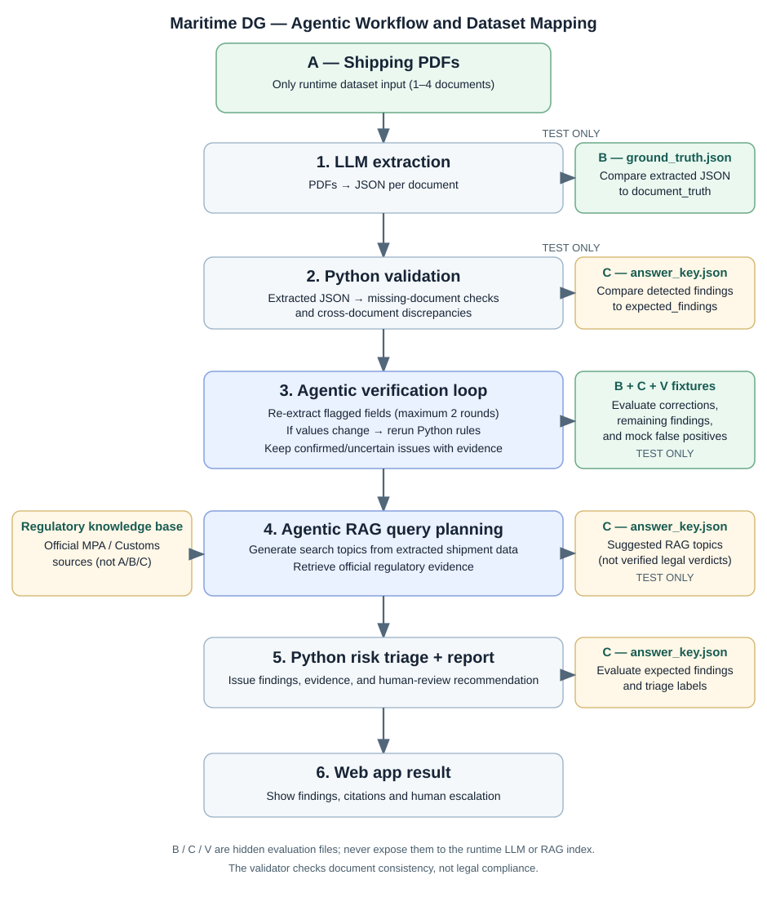

# Maritime DG Compliance Assistant — Synthetic Dataset

## Scope

**Containerised packaged dangerous-goods imports into Singapore via PSA.** This academic prototype performs document **pre-checks**, not official customs clearance, MPA/PSA notification, or regulatory approval.

## Dataset at a glance

**6 test cases · 23 synthetic PDFs · 2 JSON answer files per case**

| Label | Data | Purpose |
|---|---|---|
| **A** | Shipping documents (`.pdf`) | **System input:** Bill of Lading, Commercial Invoice, Packing List, and Dangerous Goods Declaration (DGD). |
| **B** | `ground_truth.json` | **Extraction check:** baseline shipment information (`shipment_truth`) and values actually printed in each PDF (`document_truth`), including intentional errors. |
| **C** | `answer_key.json` | **Issue check:** expected mismatches and missing documents, used to check validation findings and reporting. Regulatory verdicts are not yet labelled. |

**Only A is uploaded to the web app. B and C remain hidden during system evaluation.**

## System workflow and data mapping

1. **Upload (A):** Submit the PDFs to the web app.
2. **LLM extraction (A → JSON):** Extract the fields; compare the output with **B** to measure reading accuracy.
3. **Python checks (extracted JSON):** Find missing documents and conflicting values; compare detected issues with **C**.
4. **Regulatory RAG (extracted JSON):** Retrieve relevant Singapore requirements from a **separate, official-source knowledge base**, not the synthetic PDFs.
5. **Report and escalation:** Display findings, evidence and recommended review; use **C** to check known issue outcomes. Verified regulatory test labels must be added before scoring regulatory accuracy.

## Test scenarios

| Case | Injected issue |
|---|---|
| S01 | None — consistent baseline |
| S02 | Packing List gross cargo mass mismatch |
| S03 | Bill of Lading container ID mismatch |
| S04 | Missing DGD in uploaded documents |
| S05 | Conflicting DG class between DGD and B/L |
| S06 | Weight, container ID and DG class conflicts |

## File organisation

Each `test_cases/SXX.../` folder contains the available **PDFs (A)**, `ground_truth.json` **(B)** and `answer_key.json` **(C)**. S04 intentionally has only three PDFs.

- `dataset_manifest.csv` — test-case index.
- `build.py` — regenerates the dataset; run from the dataset root after `pip install reportlab`.
- `system_workflow.svg` — workflow diagram used above; keep it beside this README.

## Limitations

Documents are simplified **synthetic educational forms**, not legally valid declarations. The illustrative `UN1263 / PAINT / Class 3` shipment has **not** been checked for all packing, transport-description, HS-code or regulatory requirements. Injected issues are **document discrepancies**, not proven legal violations; a missing uploaded DGD does not prove that a separate MPA DG notification was omitted. Six cases from one shipment are suitable for integration and demonstration, not statistically robust evaluation.

## Video scope statement

> Our prototype focuses on containerised packaged dangerous-goods imports into Singapore via PSA. It uses synthetic shipment documents, LLM extraction, Python validation and Singapore-focused regulatory RAG to provide explainable pre-submission checks and recommend human review, rather than official regulatory clearance.
